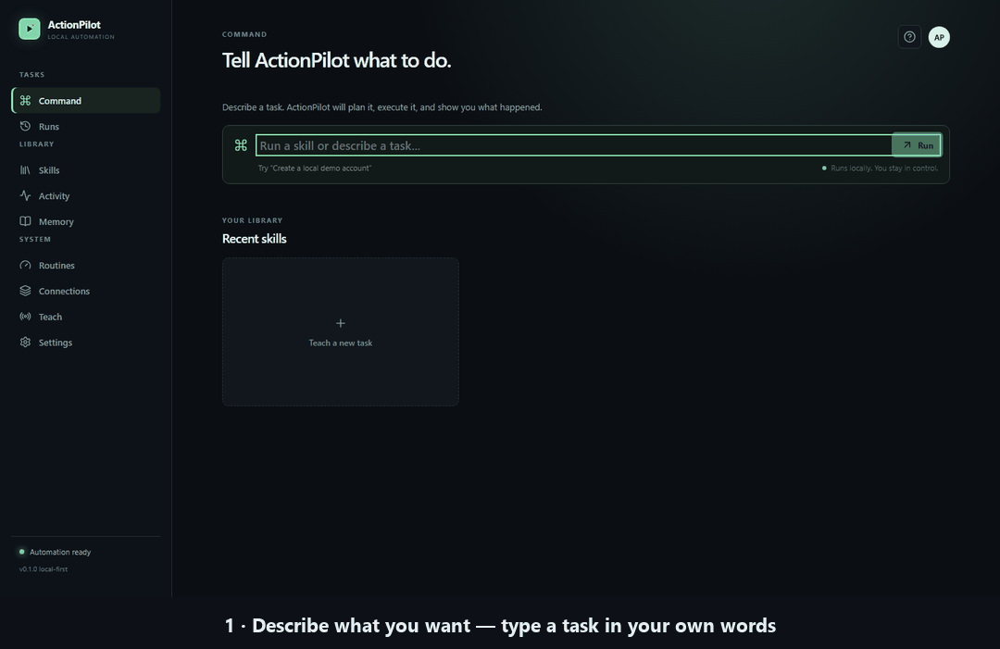

<p align="center">
  
</p>

<h1 align="center">ActionPilot</h1>

<p align="center"><b>Show it once. Let it do it again.</b></p>

ActionPilot is a local-first browser automation tool for Windows. Record a
workflow once in your browser and replay it as a reusable **Skill**, or
describe a task in your own words — ActionPilot plans it, executes it step by
step, and verifies the result, on your machine.

<p align="center">
  <a href="https://github.com/BistaDinesh03/actionpilot/actions/workflows/ci.yml"></a>
  
  
</p>

## Demo

A complete run against the bundled local demo site:



1. **Describe** a task in your own words.
2. **Review** the plan — every step and its risk level — before anything runs.
3. **Watch** it execute with live progress and a page preview.
4. **Approve** sensitive steps when asked; rejecting stops the run safely.
5. **Inspect** the result — per-step screenshots, a run video, and a timeline.

## How it works

```text
Browser extension  →  FastAPI + SQLite  →  Playwright runtime  →  Run Details
   (record actions)     (store Skills)       (replay steps)      (screenshots,
                                                                   video, timeline)
```

There are two ways to put ActionPilot to work:

- **Record a workflow** with the browser extension to create a reusable
  **Skill**. Replay it later with the same data or with different values.
- **Describe a task** in the Command box. ActionPilot matches a Skill you
  already recorded or builds an agent plan, then executes it step by step
  with observation and verification.

Whatever the route, execution stays supervised: high-risk steps pause for
your approval, recovery is bounded, and success is reported only after the
step's effect is actually observed. The extension captures normalized
actions and sends them to the local API; Skills are stored in
`actionpilot.db`, and evidence lands under `runtime/runs/<run-id>/`.

## Key capabilities

- **Record** — teach a workflow in a real browser with the Manifest V3
  extension (Chrome/Brave).
- **Save Skills** — review every captured step, trim if needed, and store it
  in a local SQLite database.
- **Replay** — run a Skill in Playwright Chromium with pause, resume, and
  stop.
- **Command** — describe a task in your own words; ActionPilot matches a
  Skill or builds an agent plan (observe → decide → act → verify → recover).
- **Variables** — rerun a Skill with different values via `{{name}}`
  placeholders.
- **Inspect** — Run Details with per-step screenshots, run video, and a
  clickable timeline.
- **Export** — download any Skill as a standalone Playwright `.spec.ts` test.
- **Stay in control** — high-risk steps pause for approval; rejection stops
  the run. Recovery and retries are hard-bounded.
- **Reliability built in** — wait and assert steps, sensitive-field
  filtering at record time, runtime risk re-classification, verified
  completion (action failures and verification failures are reported
  separately), and startup reconciliation for runs interrupted by a crash.
- **Secret-safe evidence** — audit and approval records mask typed secrets
  (`password=...` becomes `[redacted]`).

## Quick Start

Prerequisites: Windows, Python 3.11, Node.js, and a Chromium browser
(Chrome or Brave).

### 1. Install

From the project root:

```powershell
python -m venv .venv
.\.venv\Scripts\Activate.ps1
pip install -r backend/requirements.txt
cd frontend; npm install; cd ..
cd extension; npm install; npm run build; cd ..
```

Optional configuration: copy `.env.example` to `.env` and fill in
placeholders if you use the optional Gmail integration. The backend loads
`.env` from the repository root at startup; shell environment variables
always win. Never commit a real `.env`.

### 2. Start the backend and frontend

```powershell
.\scripts\dev.ps1
```

This opens the FastAPI backend at <http://127.0.0.1:8000> and the Vite
frontend at <http://localhost:5173>.

### 3. Load the browser extension

1. Open `brave://extensions` (or `chrome://extensions`).
2. Turn on **Developer mode**.
3. Click **Load unpacked** and select this repository's `extension` folder.
4. Pin **ActionPilot** to the toolbar.
5. Open the popup — it should show **Ready to teach**.

### 4. Run your first replay

```powershell
python -m playwright install chromium
```

### Optional: the local demo shop

```powershell
.\scripts\demo.ps1
```

Serves a local shop at <http://127.0.0.1:4173> for practicing recordings.

## Safety and approvals

ActionPilot treats automation as something to supervise, not to trust:

- **Risk classification** — every step carries a risk level, and it is
  re-checked immediately before the step acts.
- **Approval gate** — high-risk steps pause the run and show an approval
  card. **Approve** runs the step and continues; **Reject** stops the run
  there. A paused approval waits indefinitely until you decide.
- **Bounded recovery** — retries, re-targeting, and re-observation are
  deterministic and capped by hard budgets; mutating and destructive steps
  never retry automatically.
- **Unsupported destructive actions are refused** — for example, the desktop
  tool does not execute file deletion.
- **Filtered recording** — password, token, payment, and secret fields are
  never captured; cookies and browser storage are never read.
- **Local surface** — the API binds to `127.0.0.1` and has no
  authentication; see [Limitations](#limitations).

## Recording a Skill

1. Start the backend and frontend, then open <http://localhost:5173>.
2. Click **Teach** (sidebar) or **Teach a new task**, enter a task name, and
   click **Start teaching**.
3. In your browser, start from a blank tab and navigate to the site you want to
   automate — this becomes the Skill's first step.
4. Perform the workflow: click real controls, type values, submit forms.
5. Click the **ActionPilot** toolbar icon and choose **Stop teaching & save**.
6. Review the captured steps in the review modal, remove any noise, and click
   **Save skill**.

Tips:

- Click only meaningful elements (buttons, links, inputs, selects).
- Password, token, and secret fields are skipped automatically.
- To use a variable, type the placeholder literally during recording, e.g.
  `{{name}}`.

## Replaying a Skill

1. Open **Skills** in the sidebar.
2. Click **Run** on a Skill.
3. If the Skill contains placeholders, fill in the values when asked.
4. Watch the run on the **Runs** page — pause, resume, or stop at any time.
5. When it finishes, click any step to see its screenshot and jump the video to
   that moment. Failed runs highlight the failing step and show the exact error.

Screenshots and video are saved under `runtime/runs/<run-id>/`.

## Variables

Variables make a Skill reusable with different data.

1. During recording, type a placeholder **literally** into a form field:
   `{{name}}`, `{{email}}`, `{{message}}`.
2. Save the Skill.
3. On **Run**, ActionPilot detects the placeholders and asks for values.
4. Each run stores its values and shows them in the run record.

The braces are required — on a US keyboard, `{` is Shift+[ and `}` is Shift+].

## Exporting Playwright tests

1. Open **Skills**.
2. Click **Playwright** on a Skill — your browser downloads
   `<skill-name>.spec.ts`.
3. Run it standalone:

```powershell
npx playwright test <skill-name>.spec.ts --project=chromium
```

The export uses real Playwright APIs (`page.goto`, `getByRole`, `getByLabel`,
`expect(...).toBeVisible()`) and runs in a fresh browser outside ActionPilot.
Placeholders like `{{name}}` are preserved so you can substitute them with your
own fixtures.

## Privacy

- **Local-first:** Skills, runs, and audit records live in `actionpilot.db` and
  `runtime/` on your machine.
- **No account, no cloud, no telemetry:** no sign-in, no sync, no analytics.
- **Recording is filtered:** password, token, payment, and secret fields are
  never captured. Cookies, credentials, and browser storage are never read.
- **Network:** the app talks to your local backend and to the sites you choose
  to run against. The UI loads no remote resources at all — typography uses
  your system's built-in fonts, and nothing is fetched from a CDN.
- **Evidence is redacted:** audit records, approval cards, and run titles mask
  secret-looking text (`password=...` → `[redacted]`); approval records never
  store typed form values; agent observations never read input field values.
  Failure messages are one line (`ErrorType: message`), never a stack trace.
- **What is stored:** Skill steps keep the values you recorded (that is what
  replay needs), each run keeps its variables plus the original request text
  (an approved run resumes from that exact text), and screenshots/video live
  under `runtime/runs/<run-id>/`. Cleanup is manual: stop the app and delete
  `actionpilot.db` and `runtime/`.
- **Optional Gmail:** if enabled, the Google OAuth refresh token is stored in
  plaintext at `runtime/gmail/token.json` on your machine.

## Limitations

- **Chromium-based recording and replay.** The extension targets Chrome/Brave;
  replay runs in Playwright Chromium. Other browsers are not supported or
  verified.
- **No CAPTCHA or bot-check bypass.** Sites behind Cloudflare or reCAPTCHA may
  not complete.
- **Wait/assert steps have no UI yet.** Author them by editing the Skill JSON
  via the API (see the user guide).
- **No conditional logic** (if/else) inside Skills.
- **One run at a time.**
- **Approvals wait indefinitely.** A run paused for approval stays paused until
  you decide or stop it; there is no timeout.
- **Selector drift:** steps are recorded from the live DOM; heavily dynamic
  sites may need re-recording.
- **No scheduler** — runs start when you click Run.
- **No Skill JSON import.** Playwright test export is available; Skill
  import/export as JSON is not.
- **Local-only** — no cloud sync, accounts, or sharing.
- **No authentication:** the API binds to `127.0.0.1` and trusts every local
  process. Do not expose the port to a network you do not control.
- **Backend is Windows-only** (pywinauto/pywin32 pins); the frontend and the
  browser-only pieces have no hard Windows dependency but are only verified on
  Windows.
- **No retention automation** — old runs, screenshots, and video are kept until
  you delete them.

## Testing

```powershell
# Backend: unit + local-browser E2E tests
# (first time only: python -m playwright install chromium)
cd backend; python -m pytest -q

# Frontend: typecheck and production build
cd frontend; npm test; npm run build
```

CI runs both on every push and pull request
(`.github/workflows/ci.yml`): the backend suite on Windows (the supported
platform) and the frontend typecheck/build on Linux.

Developer-oriented tests for the adaptive execution layer are described in
[docs/PLAYGROUND.md](docs/PLAYGROUND.md).

## Project structure

```text
extension/       Manifest V3 recorder (TypeScript, esbuild)
frontend/        React + Vite UI
backend/         FastAPI server, SQLite storage, Playwright executor, agent loop
docs/            User guide, architecture, playground notes
demo-site/       Local demo shop and form pages
agent-test-site/ Static fixtures for agent E2E tests
playground-site/ Deterministic local scenarios for adaptive-execution tests
scripts/         dev.ps1 (start app), demo.ps1 (start demo shop)
runtime/         Run artifacts: screenshots, video, Gmail token (git-ignored)
```

## Documentation

- [docs/USER_GUIDE.md](docs/USER_GUIDE.md) — the full walkthrough of
  recording, replaying, variables, and the Command interface.
- [docs/ARCHITECTURE.md](docs/ARCHITECTURE.md) — design, components, and the
  safety architecture.
- [docs/PLAYGROUND.md](docs/PLAYGROUND.md) — deterministic scenarios for the
  adaptive-execution tests.

## Status

ActionPilot is a **local-first v0.1** release covering the
record → save → replay → inspect → export workflow and the command-driven
agent execution loop (observe → decide → act → verify → recover, with
approval gates and bounded budgets) on Windows. The backend ships 204 passing
tests; CI runs the backend suite on Windows and the frontend
typecheck/build on every push.

The repository also contains experimental integrations (Gmail, web research,
desktop control, memory, and routines) that are **not part of this release's
verified workflow** and may change without notice.

See [CONTRIBUTING.md](CONTRIBUTING.md) to pitch in, [SECURITY.md](SECURITY.md)
to report a vulnerability responsibly, and [CHANGELOG.md](CHANGELOG.md) for
what changed.
